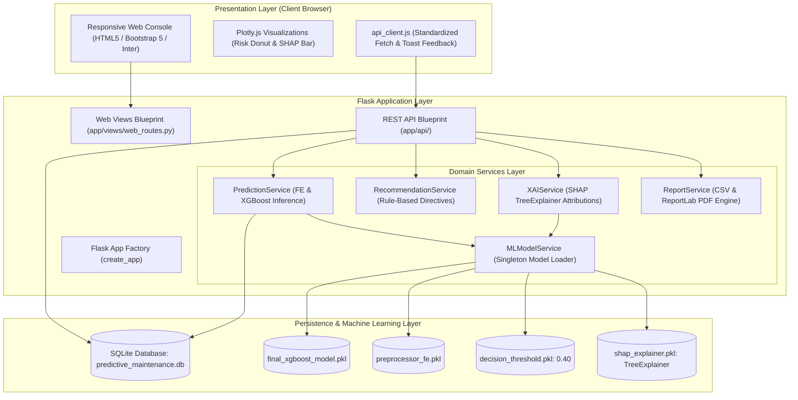

# Predictive Maintenance & Equipment Failure Intelligence System

[](https://www.python.org/)
[](https://flask.palletsprojects.com/)
[](https://xgboost.readthedocs.io/)
[](https://scikit-learn.org/)
[]()
[]()

An industry-grade, end-to-end Predictive Maintenance SaaS platform that monitors factory equipment telemetry, predicts impending machine failure using a calibrated XGBoost classifier, delivers explainable AI (SHAP) feature attributions, prescribes rule-based component maintenance directives, and generates audit-ready PDF/CSV engineering inspection certificates.

---

## 1. Problem Statement & Industrial Objective

Unplanned downtime in heavy manufacturing costs industrial facilities billions of dollars annually in lost throughput, damaged tooling, and emergency repairs. Traditional maintenance protocols alternate between:
- **Run-to-Failure (Reactive):** High risk of catastrophic equipment failure and worker injury.
- **Time-Based Overhauls (Preventative):** Premature replacement of healthy components, causing needless expense and scheduled downtime.

**Predictive Maintenance Intelligence** bridges this gap by continuously evaluating sensor telemetry (ambient & process temperatures, spindle rotational speed, drive torque, cumulative tool wear) against an optimized machine learning model. Operators receive real-time failure probability indices, risk tier classifications, and targeted component recommendations before catastrophic failure occurs.

---

## 2. Key Modules & Functional Architecture

The platform provides seven fully integrated operational modules accessible via a responsive industrial web console:

1. **Overview Dashboard:** Live KPI counters (Registered Fleet, Active Failure Alerts, Logged Predictions, Sensor Telemetry), interactive Plotly.js Fleet Risk Distribution Donut, and Unit Failure Probability Index.
2. **Machine Monitoring & Registry:** Central equipment registry supporting variant classifications (`Type L`, `Type M`, `Type H`), substring search, status filters, and historical inspection modals.
3. **Sensor Diagnostics & Failure Prediction:** Interactive telemetry input form with pre-configured simulation presets (Normal Machine A, High-Risk Machine B, Heavy Press Machine C), instant failure probability meter, and local SHAP feature attribution waterfall plots.
4. **Maintenance Action Task Board:** Prescribed engineering directives categorized by priority (`HIGH`, `MEDIUM`, `LOW`) with interactive status lifecycles (`PENDING` $\to$ `IN_PROGRESS` $\to$ `RESOLVED`).
5. **Prediction History & Audit Trail:** Chronological database log of all machine evaluations with instant PDF certificate generation for any past event.
6. **Reports & Export Hub:** Instant streaming download of consolidated fleet telemetry CSVs (RFC-4180) and executive-grade ReportLab PDF inspection certificates.
7. **System Settings & ML Diagnostics:** Inspection of active sensor alert thresholds, ML booster schema, and SQLite storage integrity.

---

## 3. System Architecture



---

## 4. Machine Learning & Feature Engineering Pipeline

### Algorithm & Serialized Artifacts
- **Classifier:** Extreme Gradient Boosting Classifier (`XGBClassifier`) loaded from `models/final_xgboost_model.pkl`.
- **Classification Threshold:** Fixed decision threshold of `0.40` (40.0% probability) loaded from `models/decision_threshold.pkl`. If $P(\text{Failure}) \ge 0.40$, status is flagged as `FAILURE RISK`; otherwise `NORMAL`.
- **Explainability:** SHAP `TreeExplainer` loaded from `models/shap_explainer.pkl` (baseline margin attribution $E[f(x)] = 0.4194$).

### Feature Engineering Pipeline
The preprocessor (`models/preprocessor_fe.pkl`) accepts 8 raw/engineered columns and transforms them into the 10-feature matrix expected by the XGBoost booster:

$$\Delta T = T_{\text{process}} - T_{\text{air}} \quad [\text{K}]$$

$$P_{\text{mech}} = \frac{\tau \times \omega \times 2\pi}{60 \times 1000} \quad [\text{kW}]$$

*Where $\tau$ is torque [Nm] and $\omega$ is spindle rotational speed [rpm].*

```
Raw Telemetry (8 Features)                      Transformed Matrix (10 Features)
- Air temperature [K]            Pipeline:      1. numerical__Air_temperature_K
- Process temperature [K]    ───────────────>   2. numerical__Process_temperature_K
- Rotational speed [rpm]     • SimpleImputer    3. numerical__Rotational_speed_rpm
- Torque [Nm]                  (median)         4. numerical__Torque_Nm
- Tool wear [min]            • StandardScaler   5. numerical__Tool_wear_min
- Temperature Difference [K]                    6. numerical__Temperature_Difference_K
- Mechanical Power [kW]                         7. numerical__Mechanical_Power_kW
- Type (L, M, H)             • OneHotEncoder    8. categorical__Type_H
                                                9. categorical__Type_L
                                               10. categorical__Type_M
```

### Risk Tiering vs. Classification Threshold
The binary threshold and risk categories serve distinct operational purposes:
- **Binary Status:** $P(\text{Failure}) \ge 40.0\% \implies \text{FAILURE RISK}$; $< 40.0\% \implies \text{NORMAL}$.
- **Risk Tiers:**
  - **LOW Risk:** $P < 20.0\%$ (Routine monitoring).
  - **MEDIUM Risk:** $20.0\% \le P < 40.0\%$ (Early warning; schedule maintenance inspection).
  - **HIGH Risk:** $P \ge 40.0\%$ (Immediate inspection required).

### Rule-Based Component Directives
Alongside machine learning probabilities, the recommendation engine evaluates sensor boundaries:
- $\text{Tool Wear} \ge 200\text{ min} \implies$ *"High tool wear: Inspect the cutting tool and assess replacement."*
- $\text{Torque} \ge 55.0\text{ Nm} \implies$ *"Elevated torque: Inspect mechanical load and drive components."*
- $\text{Rotational Speed} \le 1300\text{ rpm} \implies$ *"Low rotational speed: Inspect motor and operating conditions."*
- $\Delta T \le 8.0\text{ K} \implies$ *"Low temperature difference: Verify operating temperature sensors."*

> [!NOTE]
> **Industrial Disclaimer:** Sensor thresholds represent default operational references. In actual industrial deployments, threshold parameters must be calibrated against OEM equipment datasheets and process tolerance guidelines.

---

## 5. Dataset Information & Anti-Leakage Compliance

The model is trained on the **UCI AI4I 2020 Predictive Maintenance Dataset** (10,000 synthetic records reflecting real-world industrial milling machinery).

### Target Leakage Safeguards
- Identifiers (`UDI`, `Product ID`) are completely excluded from training and inference.
- Specific failure-mode indicators (`TWF`, `HDF`, `PWF`, `OSF`, `RNF`) represent root causes and labels; they are **never** utilized as prediction inputs.

### Classification vs. Remaining Useful Life (RUL)
The AI4I 2020 dataset provides binary failure labels within a short operational window. This model provides **binary failure risk classification** and **risk level probabilities**. It does **not** claim to predict Remaining Useful Life (RUL) in hours or cycles.

---

## 6. REST API Reference

All API routes are served under the `/api` prefix and return JSON with appropriate HTTP status codes:

| Method | Endpoint | Description | Status Codes |
| :--- | :--- | :--- | :--- |
| `GET` | `/api/health` | System health check (DB connectivity & ML model status) | `200`, `503` |
| `GET` | `/api/dashboard/stats` | Fleet KPIs and risk distributions using latest status per unit | `200` |
| `GET` | `/api/machines` | Equipment inventory with filters (`?type=M&search=Lathe`) | `200`, `400` |
| `POST` | `/api/machines` | Register new equipment (`machine_name`, `machine_type`) | `201`, `400`, `409` |
| `GET` | `/api/machines/<id>` | Retrieve single machine metadata | `200`, `404` |
| `PUT` | `/api/machines/<id>` | Update machine metadata | `200`, `400`, `404`, `409` |
| `GET` | `/api/machines/<id>/history`| Full prediction, sensor, and maintenance log history | `200`, `404` |
| `POST` | `/api/predict` | Primary inference, recommendation, and SHAP XAI endpoint | `200`, `400`, `404` |
| `GET` | `/api/predictions` | Paginated fleet-wide prediction logs (`?limit=50&offset=0`) | `200` |
| `GET` | `/api/maintenance` | Maintenance task queue with filters (`?status=PENDING`) | `200`, `400` |
| `PUT` | `/api/maintenance/<id>/status`| Transition directive state (`PENDING` $\to$ `IN_PROGRESS` $\to$ `RESOLVED`) | `200`, `400`, `404` |
| `GET` | `/api/reports/csv` | Download RFC-4180 CSV export of fleet health telemetry | `200` |
| `GET` | `/api/reports/pdf/<id>`| Download printable ReportLab PDF machine inspection certificate | `200`, `400`, `404` |

---

## 7. Installation & Local Development

### Prerequisites
- Python 3.10+ (Tested on Python 3.11.15 in Anaconda)
- SQLite3

### Step-by-Step Setup
1. **Clone or navigate to the repository:**
   ```bash
   cd Predictive_Maintenance_Intelligence
   ```

2. **Create and activate a virtual environment:**
   ```bash
   # Windows (PowerShell)
   python -m venv venv
   .\venv\Scripts\Activate.ps1

   # Linux / macOS
   python3 -m venv venv
   source venv/bin/activate
   ```

3. **Install production dependencies:**
   ```bash
   pip install -r requirements.txt
   ```

4. **Initialize database schema (non-destructive):**
   ```bash
   python -c "from app.database.migrations import run_migrations; run_migrations()"
   ```

5. **Execute the automated test suite:**
   ```bash
   pytest tests/ -v
   ```
   *Expected outcome: 29 passed in ~10 seconds.*

6. **Start the local development server:**
   ```bash
   python run.py
   ```
   Open your browser to: **`http://127.0.0.1:5000`**

---

## 8. Deployment Configurations

### A. Render (Recommended)
1. Fork or push this repository to GitHub/GitLab.
2. In Render, select **New Web Service** and connect the repository.
3. Configure the service using `render.yaml` or manual settings:
   - **Environment:** `Python`
   - **Build Command:** `pip install -r requirements.txt`
   - **Start Command:** `gunicorn wsgi:app --bind 0.0.0.0:$PORT --workers 2 --timeout 120`
4. **Persistent Disk Requirement:** Add a Persistent Disk mounted to `/var/data` and configure `DATABASE_PATH=/var/data/predictive_maintenance.db`.

### B. Hugging Face Spaces (Docker)
1. Create a new Space on Hugging Face and select **Docker** as the SDK.
2. The provided `Dockerfile` exposes port `7860` with a dedicated non-root application user and health probes.
3. Push files to the Space repository. Hugging Face Spaces will automatically build the container and launch the web interface.

### C. Persistent Storage Strategy for SQLite
> [!IMPORTANT]
> **Ephemeral Filesystem Notice:** Standard container instances (such as free-tier Render or default Docker containers) possess ephemeral filesystems. Any writes to a local SQLite database file will be wiped upon dyno restart or redeployment. For production persistence:
> 1. Attach a persistent volume/disk to the container (e.g. `/var/data`).
> 2. Set the environment variable `DATABASE_PATH=/var/data/predictive_maintenance.db`.
> 3. For enterprise scale, configure the database connection layer to interface with PostgreSQL or MySQL.

---

## 9. Automated Testing & Verification

The project includes an automated test suite across four distinct test layers:
- `tests/test_ml_service.py` (10 tests): Exact mathematical parity verification against reference Notebooks 03 and 04 (Machine A $0.05\%$, Machine B $85.46\%$, Machine C $0.07\%$, feature engineering formulas, SHAP attributions, input validation boundaries).
- `tests/test_database.py` (4 tests): Table initialization, duplicate equipment prevention, atomic transaction rollbacks, and latest-prediction-per-machine KPI logic.
- `tests/test_api.py` (8 tests): Complete coverage of REST API endpoints, status codes (200, 201, 400, 404, 409), CSV streaming, and ReportLab PDF certificate generation.
- `tests/test_views.py` (7 tests): HTTP view rendering tests verifying layout integrity across all 7 frontend modules.

Execute all tests with:
```bash
pytest tests/ -v
```

---

## 10. Security & Confidentiality Safeguards

- **No Committed Secrets:** All sensitive variables (`SECRET_KEY`) load from environment variables with fallback development placeholders.
- **Strict `.gitignore` Policy:** Virtual environments, `.env` files, temporary SQLite backup snapshots (`*.bak`, `database/*backup*.db`), and test databases are excluded from Git.
- **SQL Injection Prevention:** All queries in `app/database/queries.py` utilize SQLite parameter substitution (`?`).
- **Input Sanitization:** Telemetry inputs are strictly type-cast and validated against physical domain boundaries before entering the model pipeline.

